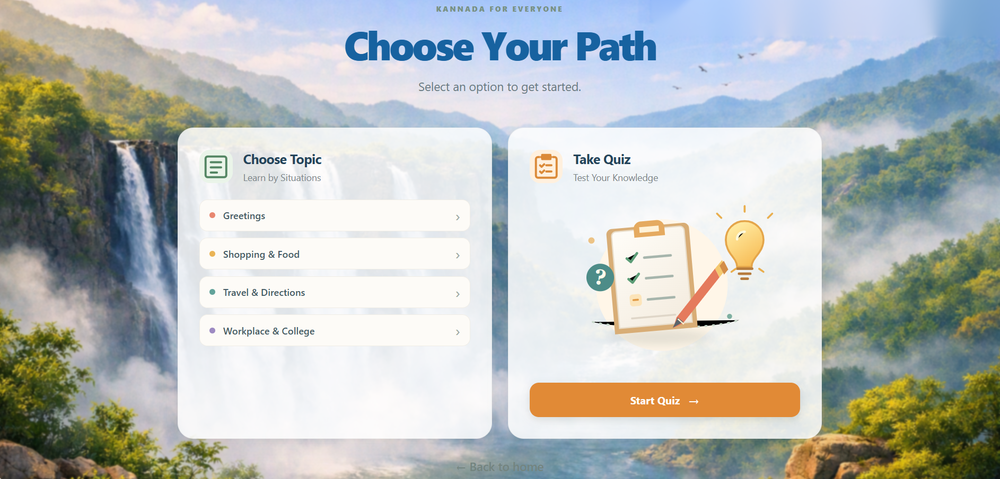
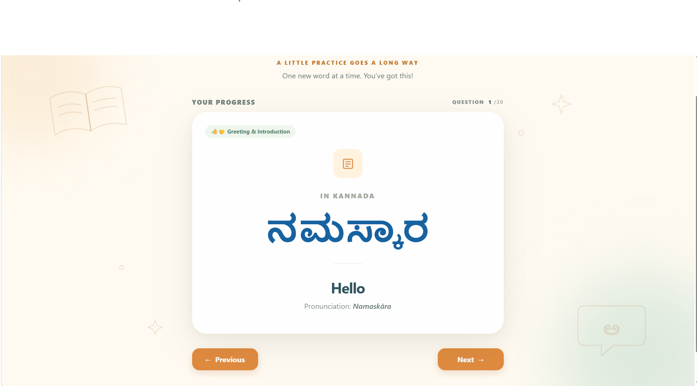
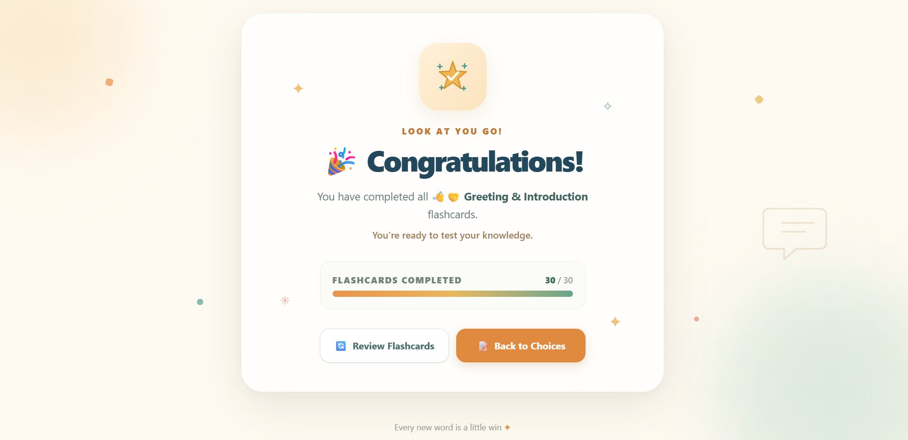
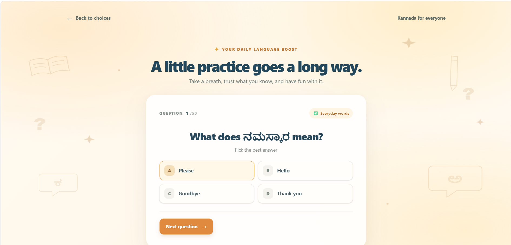
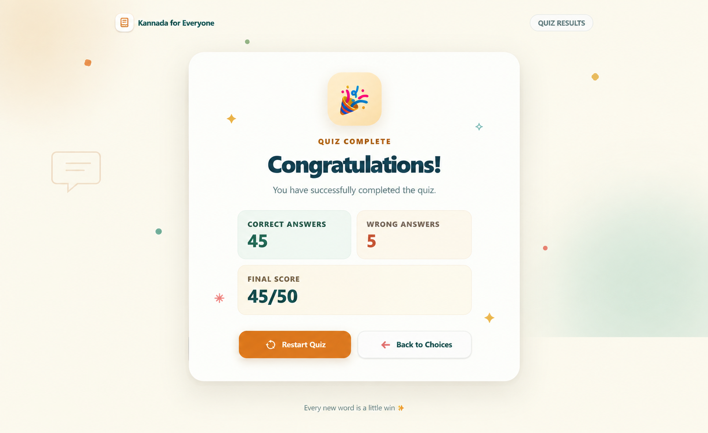

# 📚 Kannada for Everyone
### Code. Create. Celebrate Kannada. 

A simple, situation-based web app that helps beginners learn everyday Kannada through vocabulary flashcards and quizzes.

## 🌐 Live Website
Check out the live version here:  
👉 [Visit Website](https://bhumika-kiran-kamat.github.io/Kannada-for-Everyone/)

## ✨ Introduction

Learning a new language becomes easier when you connect words with real-life situations. Many beginners find it difficult to remember vocabulary and use it in everyday conversations. That’s where **Kannada for Everyone** comes in.

This web app is designed to make learning Kannada simple, practical, and engaging. With an easy-to-use interface and situation-based learning, it helps users:

- Learn useful Kannada words for everyday situations
- Understand English meanings and pronunciation guides
- Revise vocabulary using flashcards
- Test their knowledge through quizzes
- Track their quiz performance through a results dashboard

Whether you are visiting Karnataka, studying in a college, shopping, travelling, or interacting with people at work, this platform helps you get started with everyday Kannada.

The website includes five learning topics:

- Greetings
- Shopping & Food
- Travel & Directions
- Workplace & College

Each topic contains 30 vocabulary flashcards, making a total of **150 vocabulary words**. The website also includes a **50-question quiz** to help users assess their learning.

## Tech Stack

- HTML
- Tailwind CSS
- JavaScript

## 🖼️ Project Screenshots

### Front Page

### Topic Selection Page

### Vocabulary Flashcards

### Vocabulary Completed

### Quiz Page

### Results Dashboard

## 🛠️ User Instructions

1. **Open the Website**  
   Launch Kannada for Everyone in your browser.

2. **Start Learning**  
   Click **Start Learning** to explore the available topics.

3. **Choose a Topic**  
   Select from Greetings, Shopping & Food, Travel & Directions, Workplace & College.

4. **Learn Vocabulary**  
   Explore the 30 flashcards in each topic to learn Kannada words, English meanings, and pronunciation guides.

5. **Review What You Learned**  
   Complete a topic and revise its flashcards before returning to the topic selection page.

6. **Take the Quiz**  
   Answer the 50 quiz questions to test your Kannada vocabulary knowledge.

7. **Check Your Results**  
   View your score, correct answers, and wrong answers on the results dashboard.

8. **Try Again**  
   Use the **Restart** option to retake the quiz or **Back to Choices** to navigate back.

## 📌 Acknowledgments

This project was developed as an initiative to make everyday Kannada learning easier and more accessible. Microsoft Copilot ,Github Copilot was used for helpful guidance and support during the development process.

**Code. Create. Celebrate Kannada.** 